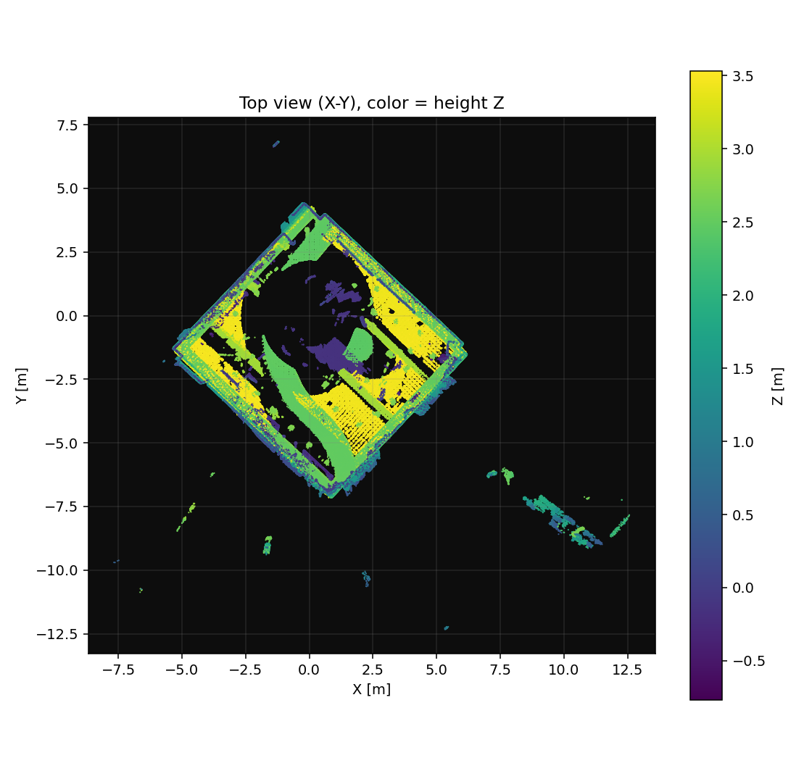

# FLMap.3

**Wired split-architecture LiDAR-inertial mapping for the Unitree Go2 + Livox Mid360.**
FAST-LIO2 runs on the robot's Orin Nano; RViz runs on your PC, over a gigabit switch.

`ROS 2 Foxy (robot)` · `ROS 2 Humble (PC)` · `Livox Mid360` · `FAST-LIO2` · `BSD-3-Clause`

---

## Why a third version

| | [FLMap](https://github.com/cj126050/FLMap) | [FLMap.2](https://github.com/cj126050/FLMap.2) | **FLMap.3** |
|---|---|---|---|
| Where LIO runs | PC | Orin Nano | Orin Nano |
| PC ↔ robot link | Ethernet | Wi-Fi | **Gigabit Ethernet + switch** |
| RTT | 0.4 ms | 2–40 ms (90 ms with power save) | **0.55 ms** |
| Jitter (mdev) | 0.1 ms | 0.1–35 ms, random | **0.12 ms** |
| Robot can roam | No | Yes | No (tether length) |
| Setup complexity | Low | **High** (cross-subnet, NAT, AP/STA) | **Low** (same subnet, no routing) |

FLMap.2 traded a lot for untethered operation: the Orin dock has no radio so you need
a USB Wi-Fi dongle, the robot sits on `192.168.12.0/24` while the dock is on
`192.168.123.0/24`, the motion controller must forward between them, multicast gets
dropped by cheap APs, and power-save pushes jitter to 40 ms. On top of that, the
motion controller on retail Go2 units **does not forward at all** (measured — see
FLMap.2 `docs/09-wireless-link.md`), which closes that path entirely.

FLMap.3 takes the other trade: **for indoor, fixed-site mapping where quality matters
more than mobility, the cable is the cheapest stability you can buy.**

What it buys:

1. **Jitter 35 ms → 0.12 ms.** The single number that decides whether live point cloud
   looks smooth or stutters.
2. **Bandwidth 1.3 → 11.6 Mbit/s, still 1.2% of gigabit.** Voxel leaf tightens from
   `0.20 m` to `0.10 m` and frame rate doubles to 10 Hz — twice the detail, same link.
3. **One whole class of silent failure disappears.** No cross-subnet routing, no NAT,
   no AP/STA switching. DDS discovery failures collapse from eight causes to three.

## Architecture

```
   ┌──────────────── Go2 Orin dock (edge) ─────────────┐       ┌──────── PC ────────┐
   │                                                   │       │                    │
   │  Mid360 ──▶ livox_ros_driver2 ──▶ FAST-LIO2       │       │  flmap_accumulator │
   │  .221              │                  │           │       │        │           │
   │              /livox/lidar      /cloud_registered  │  GbE  │        ▼           │
   │              /livox/imu               │           │       │   /flmap/map       │
   │                                       ▼           │       │        │           │
   │                                flmap_bridge ──────┼──────▶│      RViz2         │
   │                          (downsample + repack)    │ 10Mbps│                    │
   │                                       │           │ 10 Hz │                    │
   │                                       ▼           │       │                    │
   │                                /flmap/cloud ──────┘       │                    │
   └───────────────────────────────────────────────────┘       └────────────────────┘
            ▲
            │ same gigabit switch
     ┌──────┴──────┐
     │  PC .10     │
     └─────────────┘
```

**The core design is unchanged: the robot sends the *current frame*, never the map.**
The map accumulates on the PC, so link load is independent of how long you map.
That is what made the scheme work over Wi-Fi and what makes it comfortable over wire.

What changes is the budget: the link is no longer the constraint, so fidelity can go
where Wi-Fi never allowed it.

## Layout

```
FLMap.3/
├── src/
│   ├── FAST_LIO2_ROS2/      # LIO core (with gap-fix patches)
│   ├── livox_ros_driver2/   # Livox driver (lidar IP in config/MID360_config.json)
│   ├── go2_fastlio/         # LIO launch + params
│   ├── flmap_bridge/        # ★ robot: downsample + repack + rate-limit → /flmap/cloud
│   ├── flmap_accumulator/   # ★ PC: accumulate frames → /flmap/map
│   └── flmap_bringup/       # ★ launch files for both sides + RViz config
├── scripts/
│   ├── deploy_edge.sh       # rsync → Foxy patch → remote colcon build
│   ├── edge_control.sh      # robot-side console (no RViz)
│   ├── pc_view.sh           # PC-side one-shot visualization
│   ├── clock_sync.sh        # ★ time sync: PC serves, robot pulls
│   ├── link_probe.sh        # 4-layer link check (physical→net→DDS→app)
│   ├── patch_foxy.sh        # Humble → Foxy source patches (idempotent)
│   └── env_check.sh         # environment report
├── config/
│   └── cyclonedds_unicast.xml.example   # only if your switch isolates ports
├── tools/
│   ├── clock/               # ★ time server + robot-side clock tool
│   ├── diag/                # ★ diagnostics (see docs/10)
│   │   ├── dds_loopback.py  #   known-answer loopback: is the transport clean?
│   │   ├── cloud_stat.py    #   numeric distribution check: spot shifted clouds
│   │   ├── bridge_selftest.py      # self-tagging cloud → locate the shift
│   │   └── run_bridge_selftest.sh  # one-shot regression test
│   ├── fake_cloud.py        # synthetic point cloud source (no lidar needed)
│   ├── render_cloud.py      # render a cloud to PNG without RViz
│   └── bench_bridge.py      # measure real rate/bandwidth of any topic
└── docs/                    # ten documents, read in order
```

## Quick start

### 0. Prerequisites

| Item | Requirement |
|---|---|
| PC | Ubuntu 22.04 + ROS 2 Humble (desktop, with RViz2) |
| Robot | Go2 Orin dock, ROS 2 Foxy + Livox-SDK2 installed |
| Switch | **Gigabit.** 100 Mbit will drop frames at 10 Mbit/s of cloud |
| Lidar | Mid360, IP set to `192.168.123.221` (see [docs/08](docs/08-hardware.md)) |
| Cables | Three: PC↔switch, dock↔switch, lidar↔switch |

### 1. Configure the PC wired NIC

```bash
# Static IP, and NO default gateway (setting one kills your internet — docs/02 §3.3)
sudo nmcli connection add type ethernet ifname enp131s0 con-name go2-wired \
    ipv4.method manual ipv4.addresses 192.168.123.10/24 \
    ipv4.gateway "" ipv4.dns ""
sudo nmcli connection up go2-wired

ping -c3 192.168.123.18      # dock
ping -c3 192.168.123.221     # lidar
```

### 2. Time sync (**mandatory before mapping**)

```bash
./scripts/clock_sync.sh start        # PC serves time
./scripts/clock_sync.sh install      # install on robot (first time, needs sudo)
./scripts/clock_sync.sh check        # confirm offset < 10 ms
```

Skip this and RViz floods `Message Filter dropping message` — the Orin has no RTC
battery, so its clock can be years off after a power cycle.

### 3. Build on the PC

```bash
git clone https://github.com/cj126050/FLMap.3.git && cd FLMap.3
./setup.sh
```

### 4. Push to the robot and build

```bash
./scripts/deploy_edge.sh
# env: EDGE_WS=~/flmap3_ws EDGE_HOST=192.168.123.18
```

Roughly 4–8 minutes on an Orin Nano.

### 5. Start mapping on the robot

```bash
ssh unitree@192.168.123.18
cd ~/flmap3_ws && ./scripts/edge_control.sh
```

| Command | Action |
|---|---|
| `start` | begin a scan (create run dir + start recording) |
| `pause` / `resume` | toggle recording |
| `stop` | stop and export PCD |
| `status` | processes, topic rates, temperature, memory |
| `stats` | bridge compression ratio and output rate |
| `quit` | exit (auto stop) |

### 6. Visualize on the PC

```bash
./scripts/pc_view.sh
```

| RViz display | Topic | Meaning |
|---|---|---|
| Accumulated Map | `/flmap/map` | map accumulated on the PC |
| Edge Frame (live) | `/flmap/cloud` | latest frame from the robot |
| Odometry | `/aft_mapped_to_init` | current pose |
| Trajectory | `/path` | travelled path |

**Blank screen?** Run `./scripts/link_probe.sh` — it checks physical → network → DDS →
application and tells you which layer broke.

## Measured

**Setup**: Go2 dock (Orin Nano, Ubuntu 20.04 + Foxy) + gigabit switch + PC
(Ubuntu 22.04 + Humble), Mid360 at default settings, ~10 m × 10 m office.

| Metric | Value |
|---|---|
| PC → dock `192.168.123.18` RTT | **0.549 ms** avg (`ping -c 100`) |
| PC → lidar `192.168.123.221` RTT | 0.741 ms |
| NIC negotiation | `carrier=1` / `speed=1000` / `duplex=full` |
| Clock residual after sync | **−4.9 ms** (RTT 1.5 ms, re-synced every 30 s) |
| LIO residual (Orin Nano) | **0.0107**, 16023 raw → 5935 effective features/frame |
| Bridge output | `in 15921 → out 8982 pts (56.4%)`, 144 kB/msg, **11.5 Mbit/s @ 10 Hz** |
| `/flmap/cloud` on PC | **9.99 Hz**, 9075 pts/frame avg, **11.6 Mbit/s** |
| `/flmap/map` growth | **1.57 M points / 25.6 MB in 50 s** |

Top-down view of `/flmap/map`, rendered straight from the topic with
`tools/render_cloud.py` (not a screenshot):



Walls, floor (dark purple, z≈0) and ceiling (yellow, z≈3.5 m) are clearly separated.
The room sits ~45° to `camera_init` — that is the lidar mounting yaw, not drift.

> If your map collapses into "a small blob near the origin", it is almost certainly
> point packing gone wrong — see [docs/10-pitfalls.md](docs/10-pitfalls.md).
> `./tools/diag/run_bridge_selftest.sh` tells you in 15 seconds.

## Docs

| Doc | Content | Read when |
|---|---|---|
| [01-architecture.md](docs/01-architecture.md) | data flow, bandwidth math, design decisions | changing the design |
| [02-network-and-dds.md](docs/02-network-and-dds.md) | switch topology, IP plan, DDS params, symptom table | **first thing when it won't connect** |
| [03-edge-deployment.md](docs/03-edge-deployment.md) | robot deps, Foxy patches, autostart, power, watchdog | first deploy / new machine |
| [04-pc-visualization.md](docs/04-pc-visualization.md) | PC env, RViz panels, accumulator tuning, recording | making it look better |
| [05-bandwidth-tuning.md](docs/05-bandwidth-tuning.md) | bandwidth budget, fidelity vs frame rate | stutter / sharpness |
| [06-troubleshooting.md](docs/06-troubleshooting.md) | symptom-indexed playbook | something broke |
| [07-gap-fix.md](docs/07-gap-fix.md) | point cloud divergence from stream gaps | cloud suddenly flies away |
| [08-hardware.md](docs/08-hardware.md) | Mid360 wiring, IP config, mounting | installing the lidar |
| [09-time-sync.md](docs/09-time-sync.md) | why sync matters, how it works, accuracy | **drifting map / frozen RViz** |
| [10-pitfalls.md](docs/10-pitfalls.md) | "data arrives but geometry is wrong" + diagnostics | **map shape looks wrong** |

## Known limitations

- **The robot is tethered.** Radius equals cable length. Intentional trade — use
  FLMap.2 if you need mobility.
- **Cross-distro DDS.** Foxy on the robot, Humble on the PC. Works in practice with
  CycloneDDS on both ends; fallbacks in [docs/02](docs/02-network-and-dds.md) §6.
- **PC map is an accumulation, not the LIO internal map.** Revisited areas duplicate
  points until the memory cap triggers global dedup. Authoritative map is always the
  PCD exported by the robot.
- **Lidar IP must be changed first.** Mid360 ships on `192.168.1.1xx`; it will not
  appear on `192.168.123.0/24` until you change it in Livox Viewer.
- **Do not use a 100 Mbit switch.** ~11.6 Mbit/s of cloud technically fits, but it
  competes with everything else and jitter becomes unpredictable.
- **FLMap.2's visualisation was geometrically broken.** Its `flmap_bridge` used
  `PointCloud2ConstIterator::operator[]` as a point index, which advances by
  `sizeof(float)` instead of `point_step` — the cloud arrived with every component
  shifted. Fixed here from day one; see [docs/10](docs/10-pitfalls.md).

## Credits

- [FAST_LIO2_ROS2](https://github.com/Vulcan-YJX/FAST_LIO2_ROS2) — LIO core
- [livox_ros_driver2](https://github.com/Livox-SDK/livox_ros_driver2) — Livox driver
- [Unitree Go2](https://www.unitree.com/go2) — platform

Upstream packages keep their original BSD licenses; everything added here is BSD-3-Clause.
