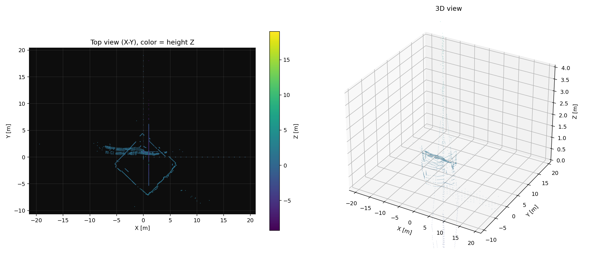
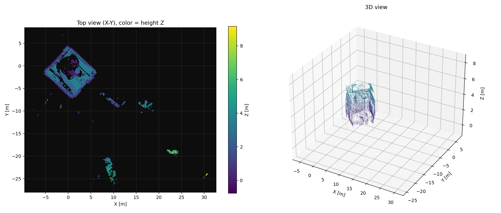

# 10 · 两个"看起来很健康"的故障

> 这篇记录的是 FLMap.3 开发过程中花了最久才定位的一类问题：**话题有数据、频率正确、
> 消息头自洽、RViz 照常出图，但点云是坏的。**
>
> 它不是配置问题，也不是环境问题，而是代码里两处"差一个 4 字节"的错误。之所以值得单独
> 写一篇，是因为常规排查手段（`ros2 topic hz` / `ros2 topic info` / 看 `point_step`）
> 全部会给出"正常"的结论。

---

## 1. 症状

建图跑起来后：

| 检查项 | 结果 |
|---|---|
| `ros2 topic hz /flmap/cloud` | 9.99 Hz ✅ |
| `/flmap/map` 点数 | 26 万，一直在涨 ✅ |
| `point_step` / `row_step` / `len(data)` | 16 / `width*16` / `height*row_step`，完全自洽 ✅ |
| RViz | 有图，动画流畅 ✅ |
| **但点云形状** | **挤在原点附近一小团，形状像狗身轮廓，不是房间** ❌ |

而在狗端导出 PCD、用 PCL 打开同一份数据时，地图是正常的。于是第一反应是
"PC 端解析错了"或"跨版本 DDS 传坏了"——**这两个猜测都是错的**。

同一段代码，修复前后各抓一帧 `/flmap/cloud` 渲染成图（`tools/render_cloud.py`）：

| 修复前 | 修复后 |
|---|---|
|  |  |
| Z 轴范围荒谬地到 −10 ~ +20 m，只剩一圈细线 | Z 轴 0 ~ 3.5 m，房间轮廓完整 |

注意左边那张图的 Z 色标：室内点云 Z 不可能到 ±20 m，这是分量串位后
"把 intensity 当成 z 读"的必然结果。

---

## 2. 排查顺序（可复用）

关键原则：**先分清"数据坏了"还是"传输坏了"，再分清"读错了"还是"写错了"。**
三步、每步都能独立给结论：

### 第 1 步：DDS 本机闭环，排除传输层

```bash
python3 tools/diag/dds_loopback.py -n 5000
```

本机发布一条数值完全已知的点云，再用原始字节读回来逐点比对。

```
round-trip: 1x5000  step=16  len=80000  payload=80000 B
错位/错值 0 / 5000 点
结论: DDS 无损 ✅ —— 问题不在传输层
```

`-n` 从 50 加到 5000（800 B → 80 kB，跨 CDR 分片）都是 0 错误，
**说明 Foxy ↔ Humble 的 `PointCloud2` 互操作、CycloneDDS 的分片重组都没有问题。**

> 顺带排除了一个常见误判：Foxy 发布、Humble 订阅时，两端 RMW 版本不同（0.7 vs 0.10），
> 很容易被怀疑是序列化不兼容。这个测试证明在本项目的数据规模下它是干净的。
> 真正的 CDR 不兼容不会只坏 payload、而让 header 一字不差。

### 第 2 步：数值分布体检，确认"坏"是什么形态

```bash
python3 tools/diag/cloud_stat.py -t /flmap/cloud -n 2
```

坏数据（修复前）：

```
[帧 0] 2726 点  step=16  row_step=43616  len=43616 OK
  x: min   -8.965  max   39.000  mean    1.045 | =0   3.0%  =1.0  20.0%
  y: min   -8.965  max   40.000  mean    0.551 | =0   7.2%  =1.0  17.2%
  z: min   -8.965  max   40.000  mean    0.386 | =0   1.6%  =1.0  18.6%
  i: min   -0.228  max  180.000  mean   23.790 | =0  62.1%  =1.0   2.6%
```

三个红灯，任何一条单独出现都值得停下来：

1. **x / y / z 三轴的 `min` 完全相同（都是 −8.965）**。真实点云三轴范围不会一样。
2. **`=1.0` 占了 17~20%**。坐标恰好等于 1.0 的比例不可能这么高。
3. **intensity 有负值（−0.228）**。Livox 反射率是 0~255 的无符号量。

修复后：

```
[帧 0] 9125 点  step=16  row_step=146000  len=146000 OK
  x: min   -6.583  max   30.575  mean    0.139 | =0   0.0%  =1.0   0.0%
  y: min  -24.445  max    6.824  mean   -0.516 | =0   0.0%  =1.0   0.0%
  z: min   -0.745  max    8.702  mean    1.537 | =0   0.0%  =1.0   0.0%
  i: min    0.000  max  205.000  mean   54.867 | =0   9.1%  =1.0   7.4%
```

点数也从 2726 涨到 9125 —— 因为错位后的坐标大量落在 `range 0.5~40 m` 之外，
被 bridge 的距离过滤直接丢掉了。

### 第 3 步：给数据"打上身份"，定位是读错还是写错

这一步是决定性的。让每个分量的值自带身份：

```
点 k:  x = k,  y = k + 1e5,  z = k + 2e5,  intensity = k + 3e5
```

于是输出里任何一组四个 float，都能反查出"它原本是第几个点的哪个分量"：

```bash
# 终端 1
ros2 run flmap_bridge flmap_bridge_node --ros-args \
    -p input_topic:=/_syn_in -p output_topic:=/_syn_out \
    -p voxel_leaf:=0.001 -p range_min:=0.0 -p range_max:=1000000.0

# 终端 2
python3 tools/diag/bridge_selftest.py -n 300
```

或者一条命令：

```bash
./tools/diag/run_bridge_selftest.sh -n 5000
```

坏的时候输出是这样的——每个 16-float 块（4 个点）里，四个分量按"点序 mod 4"旋转：

```
block0 位置:  0=i 1=x 2=y 3=z | 4=z 5=i 6=x 7=y | 8=y 9=z 10=i 11=x | 12=x 13=y 14=z 15=i
```

再往前一步，在节点里把**输入**的前三个点也打出来（`debug_dump:=1`）：

```
DEBUG input: 5000x1 step=16 row_step=80000 len=80000
  in[0] x=0.000 y=0.000 z=0.000 i=0.000
  in[1] x=0.000 y=0.000 z=0.000 i=0.010     ← 期望 (0.010, 1.000, 2.000, 1.000)
  in[2] x=0.000 y=0.000 z=0.010 i=1.000     ← 期望 (0.020, 2.000, 4.000, 2.000)
```

`in[2]` 的四个值正好是输入 float 流里下标 2/3/4/5 的元素。**读输入就错了，
问题不在写入侧，也不在传输侧。**

---

## 3. 根因：`operator[]` 不是"取第 i 个点"

`sensor_msgs::PointCloud2ConstIterator<T>::operator[]` 的实现是：

```cpp
template<...>
TT & PointCloud2IteratorBase<...>::operator[](size_t i) const
{
  return *(data_ + i);          // 步长是 sizeof(T) = 4 字节
}
```

而 `operator++` 才是按点前进的：

```cpp
V<T> & operator++()
{
  data_char_ += point_step_;    // 16 字节（x,y,z,intensity 四个 float）
  ...
}
```

头文件里的注释也写明了它的用途是 *"Access the i-th element starting at the current
pointer (useful when a field has several elements of the same type)"* ——
即**字段内部的元素索引**（比如 `count > 1` 的字段），不是点索引。

原来那段代码把四个迭代器当成随机访问数组来写：

```cpp
// ❌ 错：ix[idx] 每次只前进 4 字节，读到的不是第 idx 个点的 x
for (size_t idx = 0; idx < total; ++idx) {
  const float x = ix[idx];
  const float y = iy[idx];
  const float z = iz[idx];
  ...
}
```

读到的实际是 float 流里连续四个数：

| 想读 | 实际读到 |
|---|---|
| `ix[k]` | float 流下标 `0 + k` |
| `iy[k]` | `1 + k` |
| `iz[k]` | `2 + k` |
| `ii[k]` | `3 + k` |

也就是说 `in[k] = (S[k], S[k+1], S[k+2], S[k+3])`，每读一个点整体后移一格 ——
这正是第 3 步里看到的"旋转错位"。

### 为什么它这么难发现

因为它**只错内容，不错结构**：

- `point_step = 16`、`row_step = width * 16`、`len(data) = height * row_step` —— 全对；
- 点数、频率、带宽全都正常，`ros2 topic hz` 看不出任何异常；
- RViz 会照常渲染，因为拿到的是"合法的 float"，只是几何被搅乱；
- 甚至在狗端用 `struct.unpack_from('<4f', data, k*16)` 也是**对的**——
  写出去的数据本身是按 16 字节排的，错的只是"读进来时取了哪些字节"。

### 正确写法

**推荐**：既然只需要 x/y/z/intensity 四个 float32，直接按 `point_step` 手算偏移：

```cpp
const std::uint32_t step  = msg->point_step;
const std::uint32_t off_x = fieldOffset(*msg, "x");   // 从 msg->fields 里查
const std::uint8_t * base = msg->data.data();

for (std::size_t idx = 0; idx < total; ++idx) {
  const std::uint8_t * p = base + idx * step;
  const float x = loadF32(p + off_x);   // loadF32 = memcpy(&v, p, 4)，避免非对齐访问
  ...
}
```

**或者**：老老实实用迭代器语义，`*it` 取值、`++it` 前进，不要用 `[]` 跳点：

```cpp
for (size_t idx = 0; idx < total; ++idx) {
  const float x = *ix; const float y = *iy; const float z = *iz;
  ++ix; ++iy; ++iz;
}
```

写入侧同理。本仓库选择前一种：读写对称、行为确定，也不引入 PCL/Eigen 依赖。

---

## 4. 第二个坑：体素平均会"稀释"问题，但不会掩盖它

排查过程中还有一个容易误判的现象：**同一份 bridge 代码，狗端读自己的
`/flmap/cloud` 和 PC 端读到的数据"看起来不一样"**，于是很容易得出"跨版本传输有问题"。

实际原因是两次抓的是不同帧（点云每帧 2700~2800 点，且 `unordered_map` 顺序不稳定），
**坏数据的指纹却在两端完全一致**：

| 特征 | 狗端自读 | PC 端订阅 |
|---|---|---|
| `x/y/z` 三轴 min 相同 | −18.855 | −8.965 |
| `=1.0` 占比 | 17~20% | 17~20% |
| intensity `=0` 占比 | 62.8% | 62.1% |
| 有负 intensity | −0.218 | −0.228 |

**教训：跨机器对比不要比"具体数值"，要比"统计指纹"。** 具体坐标一定不同（帧不同），
但坏数据的分布特征会稳定复现。

---

## 5. 影响范围

这个 bug 存在于 FLMap.2 的 `flmap_bridge` 中（FLMap.3 直接沿用了那份代码），
所以：

- FLMap.2 时期 PC 端看到的所有 `/flmap/cloud`、`/flmap/map` 都是几何错乱的；
- 狗端 FAST-LIO2 的内部地图、导出的 PCD **不受影响**（那是 PCL 类型，不经过这段代码）；
- 换句话说，**建图精度没问题，一直是"可视化链路"坏了** —— 但因为它坏得很安静，
  很容易被当成"LIO 效果不好"去调参，白花很多时间。

FLMap.3 从第一版起就修好了这一段，并加了 `tools/diag/run_bridge_selftest.sh`
作为回归测试。

---

## 6. 写新代码时的检查清单

- [ ] 读 `PointCloud2` 时，是否每一步都前进了 `point_step`？
- [ ] 有没有把 `PointCloud2Iterator` 当数组用（`it[i]`）？
- [ ] 新建 `PointCloud2` 时，`point_step`、`row_step`、`len(data)` 三者是否一致？
- [ ] `fields[i].offset` 是否与 `point_step` 的计算一致？
- [ ] 改完跑一次 `./tools/diag/run_bridge_selftest.sh`。
- [ ] 抓真实数据跑一次 `cloud_stat.py`，确认三轴范围不同、`=1.0` 占比接近 0。

---

## 7. 相关工具速查

| 工具 | 用途 |
|---|---|
| `tools/diag/dds_loopback.py` | 本机已知答案闭环，判定传输层是否干净 |
| `tools/diag/cloud_stat.py` | 点云数值分布体检，找"自洽但错位"的数据 |
| `tools/diag/bridge_selftest.py` | 自解释点云 → 反查串位，定位读/写哪一侧错 |
| `tools/diag/run_bridge_selftest.sh` | 上面那步的一键版（自动起停隔离 bridge） |
| `tools/fake_cloud.py` | 没有雷达时压测 `flmap_bridge` 的降采样比与带宽 |
| `tools/bench_bridge.py` | 量任意话题的真实帧率 / 点数 / 带宽 |

另外 `flmap_bridge` 自带一个 `debug_dump` 参数（默认 0）：

```bash
ros2 run flmap_bridge flmap_bridge_node --ros-args -p debug_dump:=1
# 前两帧会打印：输入布局 + 输入前 3 点 + 发布前内存里的前 3 点
```

这三行日志能直接区分"读错 / 写错 / 传错"，建议任何改动的第一轮验证都开着。
